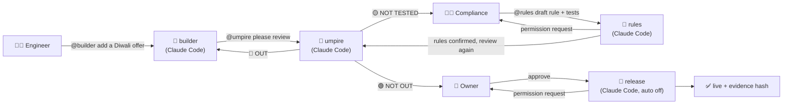

# ThirdUmpire: DRS for your AI

**Every change to a customer-facing AI bot is tested against the business's own rules, and a named person approves it in Slack before customers see it. The agents do the work; Switch makes sure only the right person can say yes.**

[Demo video (≤ 2:00)](VIDEO_LINK) · Track 01: Best Business Workflow · Flip the Switch (WeMakeDevs × Switch)

**Who it's for:** small teams and AI agencies that run a support or sales bot and change its prompt every week, with no ML team to check it.

## Proof

| | |
|---|---|
| **Real problem** | My day job: one trial-expiry sales bot (EN/HI/TE) needed **~87 prompt saves in 3 weeks** before it stopped breaking rules. Breaks were found only by test calls: 18 calls in one day, **58 recordings (87 min) reviewed by hand**, ~61 hands-on hours. |
| **After** | Same kind of change in the room: request → verdict card in **about 3 min** (40 cases × 3 runs, old vs new), instead of a day of test calls. The 40%-off "Diwali offer" was caught breaking the 20% discount rule before release. ([results](RESULTS.md)) |
| **Public precedent** | Air Canada was held liable for its chatbot's invented refund policy (Moffatt v. Air Canada, 2024). DPD's bot swore at a customer after an update (Jan 2024). |

## What happens in the room



Four verdicts, like cricket's third umpire:

| Card | Means | What happens next |
|---|---|---|
| 🔴 **OUT** | An old rule that held before now breaks (≥ 2 of k runs; one wobble gets a second look) | Back to @builder, with before/after replies and the reason |
| 🟡 **NOT TESTED** | Nothing old broke, but the change adds behaviour **no confirmed rule or test covers** | Compliance adds it to the policy, @rules drafts the rule **and** its tests, compliance confirms, umpire re-runs |
| 🟢 **NOT OUT** | Every case ran; no rule got worse; every new line is covered | Owner says "approve"; @release asks the owner for permission, then ships |
| ⚪ **NO RESULT** | Some runs could not reach a model | Run again. Never counts as a pass |

Release refuses unless: the review is NOT OUT (or the owner signs a written waiver), the candidate is the exact file that was reviewed (SHA-256), and compliance's sign-off hash matches the current **rules and test cases** (nobody can quietly weaken a test).

## How Switch is used (remove Switch and it stops working)

- **One room, four agents, three people.** The room template [`switch/thirdumpire.template.yaml`](switch/thirdumpire.template.yaml) creates the Slack channel, its instructions and four Claude Code agents: `kitebase-builder`, `kitebase-umpire`, `kitebase-rules`, `kitebase-release`.
- **Hand-offs by name.** builder → umpire → (rules) → release, with @mentions in the thread. No agent can reach the others any other way.
- **Roles enforced by Switch, not by a prompt.** [`switch/setup.py`](switch/setup.py) sets a Switch *addressing policy* per agent: builder + umpire answer only the engineer, rules only compliance, release only the owner. Switch checks it for every message **and every answer to a permission request**: when the engineer presses "Allow" on a release, Switch refuses it (`NOT_AUTHORIZED: You may not address this agent, so you may not answer it`).
- **Permission requests in Slack.** `rules` and `release` run with auto mode off, and `.claude/settings.json` marks `release`, `rollback` and `rules-confirm` as *ask* even where shell commands are allowed. Each one becomes a Switch approval card in the thread, recorded with the Slack handle that pressed it. Switch also ignores typed answers posted by apps/tokens, so a script can't approve on someone's behalf.
- **Without Switch** the agents can't see each other's work, can't hand over, and nothing stops the engineer from releasing their own change.

## Run it

Needs: Python 3.11+, [uv](https://docs.astral.sh/uv/), Docker + [Switch Console](https://github.com/sandbox-quantum/switch) 0.40+, a Slack workspace connected in Switch Console, Claude Code.

```sh
git clone <this repo> && cd thirdumpire && uv sync
THIRDUMPIRE_OFFLINE=1 uv run python -m thirdumpire review --k 3     # AI off: replays the recorded runs
uv run python -m unittest discover -s tests -t .                     # 11 fixed checks
python switch/setup.py --engineer <slack handle> --compliance <slack handle> --owner <slack handle>
```

For live reviews copy `.env.example` to `.env` and add two free keys (bot on Ollama Cloud, judge on Groq: different vendors, so the bot is never graded by itself). Then in the Slack channel: `@kitebase-builder <your change>`.

Other commands: `release --by <name> [--waiver "R5: reason"]` · `rollback --by <name>` · `rules-confirm --by <name>`.

## How it works

1. **Rules from the policy.** [`sample/kitebase/policy.md`](sample/kitebase/policy.md) → [`rules.yaml`](sample/kitebase/rules.yaml) (each rule quotes its policy sentence) → [`cases.yaml`](sample/kitebase/cases.yaml): per rule a *comply*, *break* (customer pushes), *boundary* and *no-trigger* case, plus multi-turn and prompt-injection cases.
2. **Old vs new, k runs each.** Both prompts play every case with mock tools (refund, discount, escalate, privacy request).
3. **Grade with code first.** Tool called / not called, argument caps (`offer_discount.percent ≤ 20`), regex on the reply. A cross-vendor LLM judge answers only the one yes/no question code can't.
4. **Diff.** Per-rule pass^k old vs new, flipped cases, an exact paired (McNemar) test, a second look for one-off wobbles.
5. **Coverage.** The judge maps every added prompt line to the rules that cover it. A line with no rule, or a rule with no cases, is **NOT TESTED**.
6. **Evidence pack.** `runs/<time>/evidence.json`: diff, hashes, models, every transcript, approvals; SHA-256 posted on the card.

## Sample data

Kitebase is a **fictional** SaaS company (notes app), made up for this demo: a 48-line support policy, 12 rules, 40 cases, 6 mock accounts. No client data is in this repo.

## Honest limits

- Tests catch only what they test (like DRS judging only what the cameras saw). NOT TESTED narrows the gap: nothing reaches customers untested and unapproved without a named person saying so in writing.
- ~40 cases can't prove small regressions; the card leads with clear rule breaks. Simulated customers are not real customers.
- Text bots only today. My real bots are voice bots (EN/HI/TE); voice + Indian-language cases are next.
- In the demo, compliance and owner are my own extra Slack accounts.

## How it was built

- Built solo, 4–7 Nov 2026, for Flip the Switch. All code written in the hackathon window.
- **AI assistance:** I directed Claude Code (by voice, Wispr Flow) and reviewed every change. In the product: bot `gpt-oss:120b` (Ollama Cloud free), judge `qwen3.8-27b` (Groq free).
- Stack: Python stdlib + PyYAML, Switch Console 0.40.1, Slack, Claude Code agents.

## Licence

MIT
